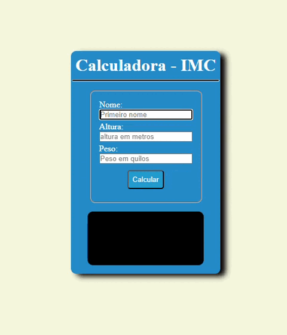
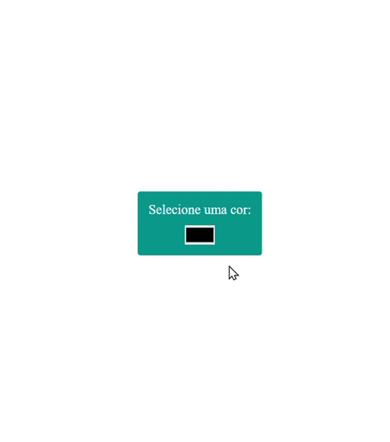
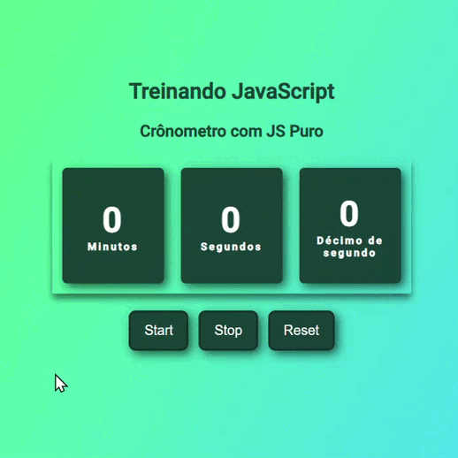
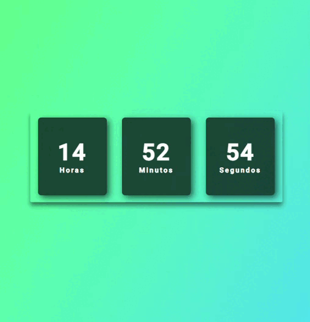
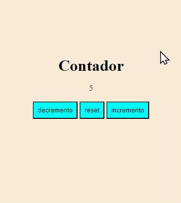
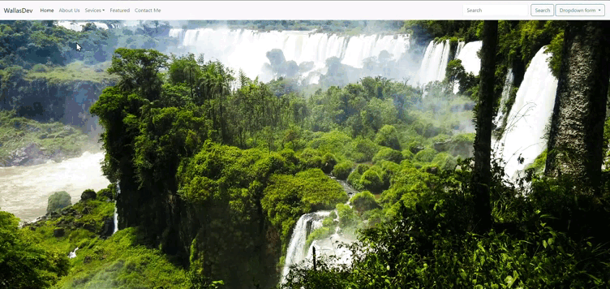
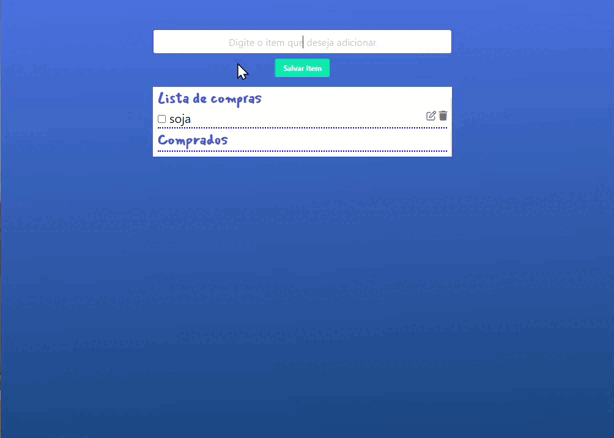
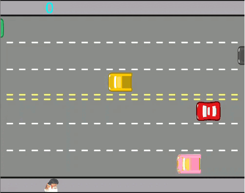
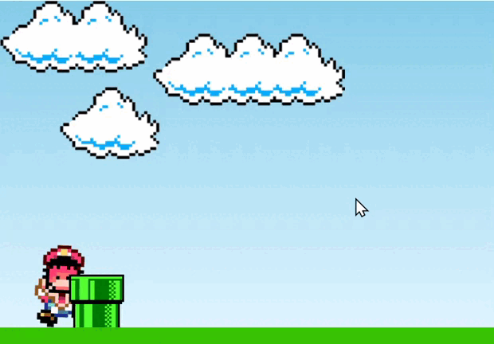
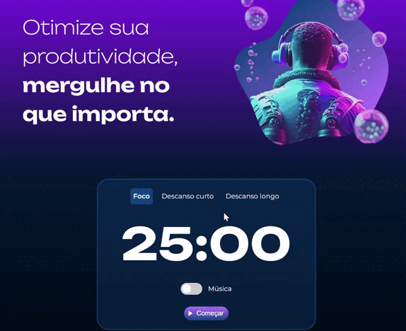

# Olá, sou Maycon Wallas 👋

Desenvolvedor Front-End apaixonado por JavaScript, React e experiência do usuário.

🚀 Atualmente estudando:
- React
- TypeScript
- Node.js

💻 Principais Tecnologias:
- HTML
- CSS
- JavaScript
- Git
- GitHub

📫 Contato:

 
  
   

## 📌 Projetos em Destaque:

           
